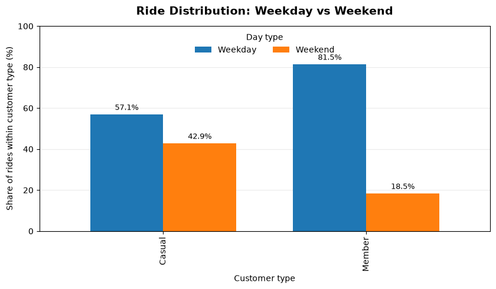
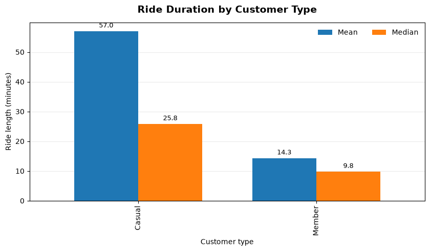

# Cyclistic Bike-Share: What 3.8 Million Trips Reveal

*A data-analysis case study comparing how casual riders and annual members used Chicago's bike-share service in 2019.*

## The question

Cyclistic is the fictional company in this case study; the historical trip records come from Divvy. The business question is straightforward:

**How do casual riders and annual members use the bikes differently, and what could those differences suggest about converting casual riders into members?**

I focused on three parts of rider behaviour: **how many rides each group takes, when those rides happen, and how long they last.**

## The headline findings

After combining and cleaning the four 2019 quarterly files, the analysis contained **3,817,991 trips**.

| Finding | What the data showed |
|---|---|
| Share of rides | Members accounted for **76.9%** of rides; casual riders accounted for **23.1%**. |
| Weekend pattern | **42.9%** of casual rides happened on weekends, compared with **18.5%** of member rides. |
| Average ride length | Casual rides averaged **57.0 minutes**, compared with **14.3 minutes** for members. |
| Median ride length | The median was **25.8 minutes** for casual riders and **9.8 minutes** for members. |
| Share of total ride time | Based on ride counts multiplied by average ride length, casual rides represented about **54.4%** of total ride time despite being 23.1% of rides. Very long rides are included in this calculation. |

The pattern is more interesting than ride counts alone suggest: members generate most trips, while casual rides tend to be longer and are much more concentrated on weekends.

## Explore the charts

### When do members and casual riders ride?



The chart shows each group's own split between weekdays and weekends. Member rides were mainly on weekdays; casual riders had a much larger weekend share.

### How long are their rides?



Both the mean and median were higher for casual riders. The mean is especially affected by very long rides, which is why I looked at the median as well when describing a typical trip.

## How I approached the analysis

1. **Prepare:** Inspected four quarterly CSV files and checked their shapes, column names, data types, missing values, and duplicate rows.
2. **Combine:** Standardized the inconsistent Q2 column names, then concatenated all four quarters into one dataset.
3. **Clean:** Removed `gender` and `birthyear` because they were not needed for the business question; parsed timestamps; removed commas from the supplied `tripduration`; and standardized `Subscriber`/`Customer` to `Member`/`Casual`.
4. **Create analysis fields:** Calculated `ride_length` from `end_time - start_time` in seconds and derived `day_of_week` from the ride start timestamp.
5. **Check unusual records:** Removed the **13 trips with non-positive calculated ride lengths**. I also reviewed unusually long trips and compared the supplied `tripduration` with the timestamp-derived `ride_length` for the longest records. I did **not** automatically remove long rides just because they looked extreme.
6. **Analyze:** Used pandas counts, `groupby`, and cross-tabulations to compare rider types, weekday/weekend behaviour, and mean and median ride length.
7. **Share:** Built charts and a presentation to communicate the findings and possible business actions.

The cleaning and analysis steps are documented in the two notebooks in [`notebooks/`](notebooks/).

## From finding to business action

These are **ideas to test, not proven outcomes**. The trip data shows behavioural differences, but it does not show whether a specific campaign would increase memberships.

- **Test a weekend-focused offer.** Casual riders take a much larger share of their trips on Saturdays and Sundays.
- **Explain the value for longer rides.** Compare actual pass prices and terms before claiming that membership would save a casual rider money.
- **Time campaign messages around the weekend.** Run a measured pilot before and during higher-casual-activity periods, then compare engagement and membership sign-ups with a suitable baseline.

## What I learned along the way

This project was not a perfectly straight line from question to answer.

I first tried exploring the data in a spreadsheet. With millions of rows, that workflow became impractical on my setup, so I moved the full-year processing and repeatable checks into Python and pandas. That was a useful lesson in itself: choosing a tool is part of doing the analysis well.

The long rides were another important decision point. It would have been easy to delete every unusually large value and make the averages look tidier. Instead, I compared the source duration with the duration calculated from the timestamps. I couldn't justify treating every long ride as an error just because it was unusual, so I kept positive-duration long rides and documented how they affect interpretation.

The main lesson I took from this case study is that analysis is not only about producing a chart. It is also about checking the data, explaining decisions, resisting unsupported assumptions, and making the result useful to someone making a business decision.

## Limitations

- The analysis covers **2019** data; rider behaviour may have changed since then.
- The data counts **trips**, not unique people.
- Trip purpose is not recorded. Weekday and weekend patterns alone cannot prove that a ride was for commuting or leisure.
- Very long positive-duration rides were retained. They lift the mean, so the mean and median tell different parts of the story.
- Pricing, marketing exposure, and membership conversion outcomes are not included, so the recommendations would need further data and controlled testing.

## Project files

```text
bike-share-case-study/
├── README.md
├── requirements.txt
├── .gitignore
├── notebooks/
│   ├── bike_share_cleaning.ipynb
│   └── bike_share_analysis.ipynb
├── images/
│   ├── 01_weekly_riding_pattern.png
│   └── 02_ride_duration.png
├── presentation/
│   └── bike_share_case_study.pptx
└── data/
    └── README.md
```

The raw and cleaned CSV files are kept out of the public repository because the full-year datasets are large. The `data/README.md` explains where to obtain the source files and how to organize them locally.

## Reproduce the analysis

1. Install the packages in [`requirements.txt`](requirements.txt).
2. Download the four 2019 quarterly Divvy trip files from the [Divvy historical data page](https://divvybikes.com/system-data) or the [Divvy trip-data archive](https://divvy-tripdata.s3.amazonaws.com/index.html). Follow the [Divvy Data License Agreement](https://divvybikes.com/data-license-agreement).
3. Place the CSVs in `data/raw/` using the filenames referenced in the cleaning notebook.
4. Update the notebook's original computer-specific file paths to paths relative to this project. Save the cleaned output to `data/processed/bike_share_cleaned.csv`.
5. Point the analysis notebook to that cleaned file and run the notebook cells in order.

**Note:** The notebooks were developed locally. Before running them on another computer, check the current working directory and update the file paths accordingly. The notebooks and charts are provided for review; the source trip data is not bundled in this repository.

## Tools

Python · pandas · NumPy · Matplotlib · Jupyter Notebook · Spreadsheet exploration

---

*This is a learning portfolio project based on a published case-study scenario. The analysis and recommendations are my work; they do not represent Cyclistic or Divvy.*
